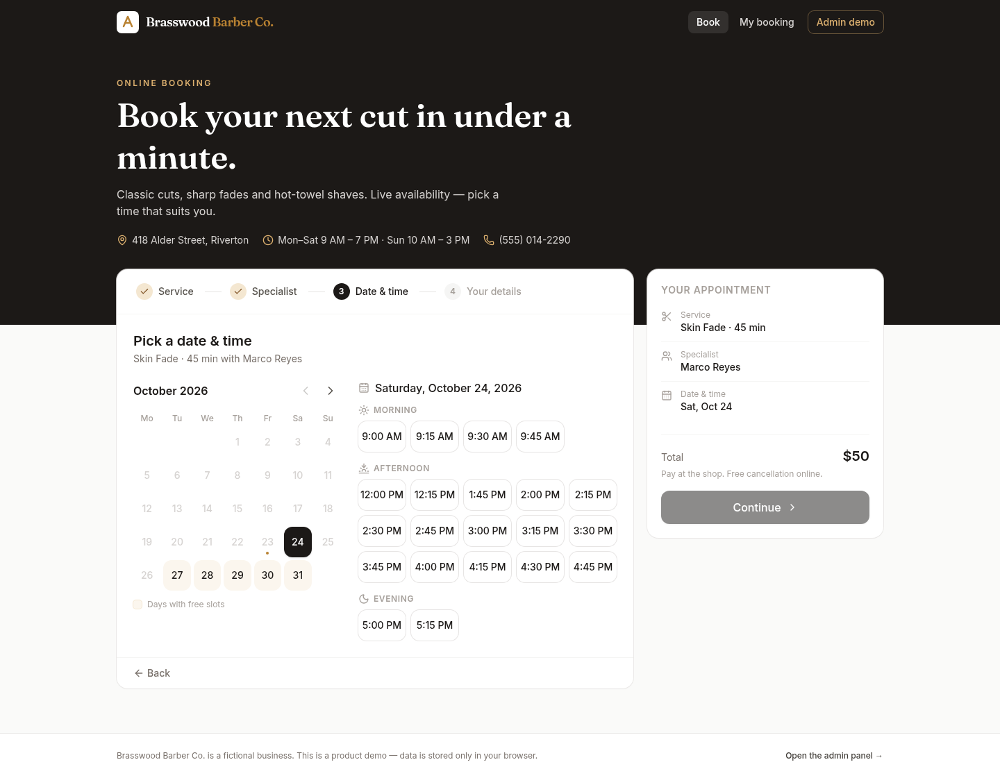

# Brasswood Barber Co. — Online Booking + Admin (demo)

A complete appointment-booking product for a service business (barbershop, salon, studio, clinic):
a fast customer booking flow and a full admin panel. Runs as a **static site with zero backend** —
data lives in `localStorage` behind a repository interface, so it can be swapped for a real API.

> Brasswood Barber Co. is a fictional business. All names, phones and emails in the seed data are made up.

**Admin demo login:** `admin` / `demo` (shown on the login page).



## Features

**Customer booking (`/`)**
- 4-step flow: service → specialist (or "Any available") → date & time → details
- Real availability: slots are computed from each specialist's working hours, breaks, days off,
  service duration, minimum notice and existing bookings — **no double booking** (re-checked at submit time)
- "Any available" assigns the least-loaded free specialist
- Month calendar that highlights days with free slots; mobile date strip + sticky action bar
- Confirmation screen with booking code, "Add to calendar" (.ics) and a manage link
- `/manage` — look up a booking by code and cancel it (the slot is released immediately)

**Admin panel (`/admin`)**
- Dashboard: today's bookings, upcoming count, 7-day revenue vs prior week, no-show rate,
  21-day revenue chart (earned vs booked), staff utilisation, top services, today's schedule
- Schedule: day view (column per staff) and week view, staff filter, off-hours/breaks/days off shading,
  "now" line; click a booking to change status (confirmed / completed / no-show / cancelled),
  reschedule (conflict-checked) or delete; click an empty slot to create a booking
- Services: create / edit / hide / delete (price, duration, category, description)
- Staff: create / edit / deactivate, colour, title, which services they perform
- Hours & days off: weekly hours with breaks per specialist, staff or whole-shop days off
  (warns about affected bookings)
- Clients: search, sort, booking history, total spent, no-shows, notes
- "Reset demo data" regenerates a realistic, deterministic dataset around today's date

## Stack

Vite · React 19 · TypeScript · Tailwind CSS v4 · React Router · lucide-react. No backend, no tracking.

## Architecture

```
src/
  lib/          types, date helpers, availability engine (pure functions), .ics export, demo auth
  data/
    repository.ts            DataSource interface (services, staff, timeOff, clients, bookings, availability)
    localStorageDataSource.ts  implementation on localStorage (simulated latency, cross-tab sync)
    seed.ts                  deterministic seed: 8 services, 3 staff, ~3 weeks of bookings
    index.ts                 `export const api: DataSource = new LocalStorageDataSource()`
    hooks.ts                 useQuery / useCatalog (re-run on data changes)
  components/   UI kit (buttons, inputs, modals, toasts, badges), calendar, booking modals
  pages/booking/  customer flow + manage booking
  pages/admin/    login, layout, dashboard, schedule, services, staff, hours, clients
```

All UI talks to the async `DataSource` interface only. To go live, implement it with `fetch`
calls to your API (Supabase, Cloudflare Workers + D1, Firebase, …) and change one line in `src/data/index.ts`.
The availability engine in `src/lib/availability.ts` is pure and can be reused on the server.

## Run locally

```bash
npm install
npm run dev        # http://localhost:5173
npm run build      # production build → dist/
npm run preview    # serve dist/ on http://localhost:4173
```

End-to-end smoke test (books an appointment, verifies it in admin, cancels it, mobile flow) and screenshots to `shots/`:

```bash
npm run preview &
CHROME_PATH=/path/to/chrome npm run e2e
CHROME_PATH=/path/to/chrome npm run e2e:history   # browser Back/Forward/reload checks (desktop + mobile)
```

## Deploy to Cloudflare Pages

**Dashboard:** Workers & Pages → Create → Pages → connect the Git repo →
Framework preset *Vite* (or none) · Build command `npm run build` · Output directory `dist`.

**CLI:**

```bash
npm run build
npx wrangler pages deploy dist --project-name brasswood-booking
```

`public/_redirects` (`/* /index.html 200`) makes client-side routes like `/admin/schedule` work on refresh.

## Demo limitations

- Data is stored per browser (`localStorage`); each visitor gets their own sandbox.
- Admin auth is a demo gate (session storage), not real security.
- No real email/SMS notifications — the confirmation screen notes that one would be emailed in the live product.
- Times are shown in the visitor's local timezone.
