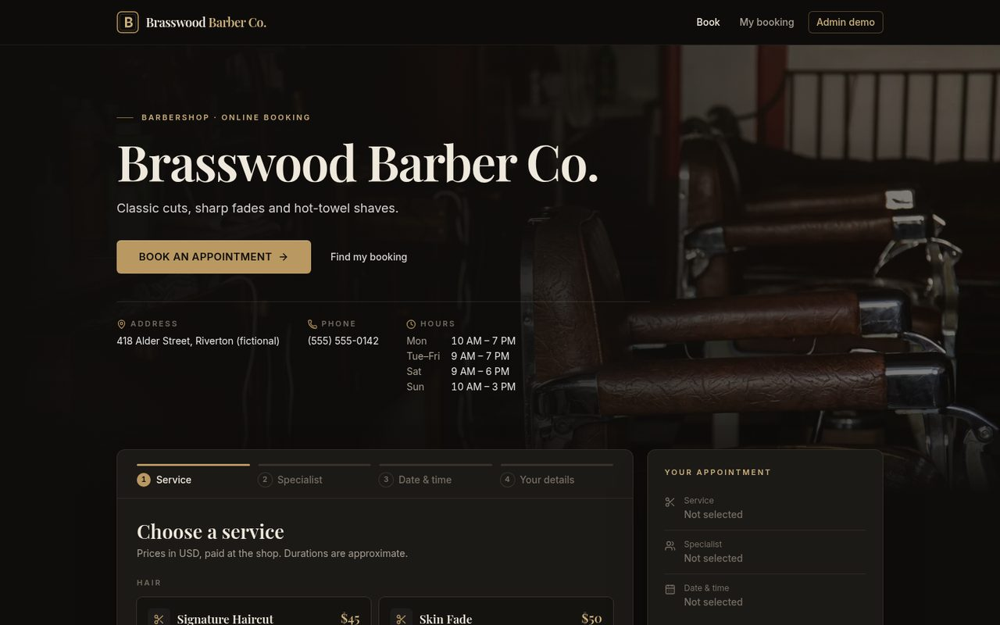
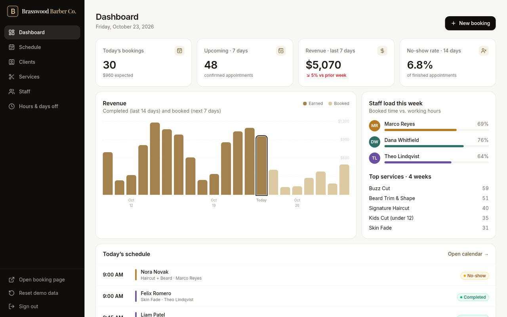

# Brasswood Barber Co. — Online Booking + Admin (demo)

A complete appointment-booking product for a service business (barbershop, salon, studio, clinic):
a fast customer booking flow and a full admin panel. Two builds from the same code:

- **API build (default, `npm run build`)** — React SPA + **Cloudflare Pages Functions** (`/api/*`) + **Cloudflare D1**
  (SQLite). Data is shared by all visitors and persists on the server; the admin panel needs a real password
  checked on the server (HttpOnly session cookie).
- **Static demo (`npm run build:demo`)** — the original zero-backend demo: data in each visitor's `localStorage`,
  demo login `admin` / `demo`.

> **Live demos**
> - Redesign + D1 backend (this branch, `remote-test`): https://brasswood-test.pages.dev
> - Classic static demo (branch `main`, data in `localStorage`): https://brasswood-booking.pages.dev
>
> Status: the API build runs as a separate **test** environment (`brasswood-test` Pages project + its own D1 database).
> It is a portfolio demo, not a production system. See "Before real customers" below.

> Brasswood Barber Co. is a fictional business. All names, phones, emails and prices in the seed data are made-up samples.

**Admin login:** API build — `ADMIN_USERNAME` / `ADMIN_PASSWORD` server secrets (nothing is shown on the login page).
Static demo build — `admin` / `demo` (shown on the login page).




## Branches

| Branch | What it is |
|---|---|
| `remote-test` (default) | Latest version: premium dark redesign of the client site, D1 backend, shop-timezone handling, remote test tooling |
| `d1-backend` | First Cloudflare D1 + Pages Functions backend (verified locally only) |
| `main` | Original zero-backend demo: everything in `localStorage` (live at brasswood-booking.pages.dev) |

## Features

**Customer booking (`/`)**
- 4-step flow: service → specialist (or "Any available") → date & time → details
- Real availability: slots are computed from each specialist's working hours, breaks, days off,
  service duration, minimum notice and existing bookings — **no double booking** (re-checked at submit time)
- "Any available" assigns the least-loaded free specialist
- Month calendar that highlights days with free slots; mobile date strip + sticky action bar
- Confirmation screen with booking code, "Add to calendar" (.ics) and a manage link
- `/manage` — look up a booking by code and cancel it (the slot is released immediately)

**Admin panel (`/admin`)**
- Dashboard: today's bookings, upcoming count, 7-day revenue vs prior week, no-show rate,
  21-day revenue chart (earned vs booked), staff utilisation, top services, today's schedule
- Schedule: day view (column per staff) and week view, staff filter, off-hours/breaks/days off shading,
  "now" line; click a booking to change status (confirmed / completed / no-show / cancelled),
  reschedule (conflict-checked) or delete; click an empty slot to create a booking
- Services: create / edit / hide / delete (price, duration, category, description)
- Staff: create / edit / deactivate, colour, title, which services they perform
- Hours & days off: weekly hours with breaks per specialist, staff or whole-shop days off
  (warns about affected bookings)
- Clients: search, sort, booking history, total spent, no-shows, notes
- "Reset demo data" regenerates a realistic, deterministic dataset around today's date (static demo only)

## Stack

Vite · React 19 · TypeScript · Tailwind CSS v4 · React Router · lucide-react.
Backend: Cloudflare Pages Functions (TypeScript) · Cloudflare D1 · wrangler (devDependency only). No tracking.

## Architecture

```
src/                         React SPA (same UI for both builds)
  lib/availability.ts        pure availability engine — used by the browser AND by the server
  lib/auth.ts                picks serverAuth.ts (API) or demoAuth.ts (static demo) at build time
  data/
    repository.ts            DataSource interface
    httpDataSource.ts        API build: fetch('/api/...'), 409 → BookingConflictError, 401 → back to login,
                             refresh on tab focus / every 20 s / BroadcastChannel between tabs
    localStorageDataSource.ts  static demo build
    index.ts                 chooses the implementation from VITE_DATA_SOURCE (api | local)
functions/api/               Cloudflare Pages Functions (file-based routing)
  _middleware.ts             JSON errors, DB binding check
  [[path]].ts                public API
  admin/_middleware.ts       every /api/admin/* needs a valid session (else 401) and same Origin (else 403)
  admin/[[path]].ts          admin API
server/                      shared server code: router, validation, D1 repository, bookings, auth
migrations/0001_init.sql     D1 schema (services, staff, hours, time off, clients, bookings, settings,
                             admin_sessions, login_attempts)
migrations/0002_data_versions.sql  1-row change counters (catalog / bookings / clients) + indexes for search & ranges
seed/seed.sql                base data: settings, services, staff, hours — no clients, no bookings
                             (regenerate with `node scripts/gen-seed.mjs --base`)
wrangler.toml                Pages project + D1 binding `DB` (database_id is a PLACEHOLDER)
```

**Build switch.** `.env` sets `VITE_DATA_SOURCE=api`, `.env.demo` sets `local` (Vite *modes*, so no `cross-env`
and the same commands work in PowerShell, cmd and bash). The value is a compile-time constant: the API bundle
contains no demo login, no demo credentials, no seed data and no localStorage data source.

**API (all JSON).**

| Public (no login) | Admin (`/api/admin/*`, session cookie) |
|---|---|
| `GET /api/health` | `GET/POST/PUT/DELETE /services`, `/staff`, `/time-off` |
| `GET /api/services`, `/api/staff`, `/api/settings` | `GET /clients`, `GET/PUT /clients/:id` |
| `GET /api/availability/slots · open-dates · next` | `GET /bookings?from&to&staffId&clientId&status`, `GET /bookings/:id` |
| `POST /api/bookings` (always `source=online`, rules enforced) | `POST /bookings`, `PATCH /bookings/:id/status`, `POST /bookings/:id/reschedule`, `DELETE /bookings/:id` |
| `GET /api/bookings/by-code/:code`, `POST …/cancel` | `PUT /settings` |
| `GET /api/auth/me`, `POST /api/auth/login`, `POST /api/auth/logout` | |

Public responses never contain client names, emails or phones (availability returns only times and
specialist ids; a booking looked up by its code has `clientId` blanked).

**No double booking.** The server recomputes availability with the same engine (hours, breaks, days off,
minimum notice, horizon, existing bookings — in the shop's timezone from Settings) and then writes with a single
atomic `INSERT … SELECT … WHERE NOT EXISTS (overlapping non-cancelled booking for that specialist)`;
`UPDATE` for reschedule / restore uses the same guard. A partial UNIQUE index on `(staff_id, date, start_min)`
is the last line of defence. Losing requests get **409**, and the UI sends the customer back to pick another time.

**Admin auth.** `POST /api/auth/login` checks `ADMIN_USERNAME` + `ADMIN_PASSWORD` (≥ 10 chars) or
`ADMIN_PASSWORD_HASH` (PBKDF2, `npm run hash-password -- "your password"`) with a constant-time compare.
Success creates a random session token (only its SHA-256 is stored in D1, 12 h lifetime) in an
`HttpOnly; SameSite=Strict; Secure` cookie scoped to `/api` (`Secure` is omitted only on localhost).
5 failed logins per IP per 15 minutes → 429. Admin writes from another Origin → 403.

## Run locally (API + local D1)

Requires **Node.js 22+** (wrangler 4 does not run on Node 20). Commands are identical in PowerShell and bash.

```bash
npm install
cp .dev.vars.example .dev.vars        # PowerShell: Copy-Item .dev.vars.example .dev.vars
#   then edit .dev.vars and set your own ADMIN_PASSWORD (≥ 10 characters)
npm run db:migrate:local              # creates the local D1 in .wrangler/state (no Cloudflare account needed)
npm run db:seed:local                 # services, staff, hours (no clients/bookings)
npm run dev:api                       # build + wrangler pages dev → http://localhost:8788
```

Optional:

- `npm run dev` (in a second terminal, while `dev:api` runs) — Vite with hot reload on http://localhost:5173,
  `/api` is proxied to :8788.
- `npm run db:seed:demo:local` — also load the demo clients/bookings into the local DB.
- `npm run db:reset:local` — wipe the local DB and re-create it (migrate + base seed).
- Static demo as before: `npm run dev:demo`, or `npm run build:demo` → `dist-demo/` and `npm run preview:demo`.

Nothing here talks to your Cloudflare account: only `wrangler pages dev`, `wrangler d1 migrations apply --local`
and `wrangler d1 execute --local` are used.

## Tests

```bash
npm run build && npm run e2e:api       # starts its own wrangler on :8799 with a throw-away local D1 (.wrangler/e2e-state)
npm run dev:api                        # then, in another terminal:
npm run e2e -- --mode=api              # UI smoke test against :8788
npm run e2e:history -- --mode=api      # Back/Forward/reload checks against :8788
npm run build:demo && npm run preview:demo   # static demo on :4173, then:
npm run e2e                            # and npm run e2e:history
npm run test:unit                      # shop-time / DST unit tests, run under 6 process time zones
npm run build && npm run e2e:tz        # own wrangler on :8796 (TEST_CLOCK=1, throw-away D1): UI in UTC, Europe/Prague,
                                       # Asia/Tokyo, America/Los_Angeles with a fixed clock + admin polling checks
```

**Time zone.** Everything time-related — slots, "today", past/upcoming, whether a booking can still be cancelled
online — uses the shop timezone from Settings (default America/New_York) on the server, in the browser and in the
demo, via `src/lib/shopTime.ts`. The visitor's browser timezone does not matter; pages show "shop time (New York)"
when it differs. The server also returns `canCancel` for a booking. `.ics` files use UTC timestamps.

**Admin refresh (D1 reads).** The admin checks `GET /api/admin/changes` (one row: `catalog`/`bookings`/`clients`
counters, bumped in the same D1 batch as every write) and refetches only the lists whose scope changed.
Every 20 s while active, slowing to 60 s when idle (no input for ~5 min), paused while the tab is hidden, an
immediate check on focus/visibility; tabs share results via BroadcastChannel. Public pages check `/api/changes`
the same way. The Clients page is paginated server-side (`/api/admin/clients/summary`, 50 rows per page).

`TEST_CLOCK=1` (only passed as `--binding` by `e2e:tz`) lets the `x-test-now` header move the server clock.
It must never be set in `wrangler.toml` or in Cloudflare; `check:bundle` and `verify:remote` fail if it is.

```bash
npm run check:bundle                   # build + functions bundle; fails if the .dev.vars password / demo login is inside
npm run verify:remote:local            # proves scripts/verify-remote.mjs against local wrangler + throw-away D1, row counts before = after
```

`e2e:api` proves: a booking made in one browser is visible in the admin of a separate fresh browser and the
slot is taken there; data and sessions survive a server restart; 401 without a cookie, wrong password rejected,
login rate limit, cross-origin writes rejected, admin password not in the bundle; public endpoints don't leak
names/emails/phones; 10 parallel creates for one slot → exactly 1 × 201 + 9 × 409 (also for overlapping start
times, admin creates and "any specialist"); reschedule into a taken/overlapping slot → 409.

The UI suites in `--mode=api` write to your local dev DB (`npm run db:reset:local` cleans it) and read the
admin password from `.dev.vars`. Chrome is taken from `CHROME_PATH` (default `/usr/bin/google-chrome`);
on Windows: `$env:CHROME_PATH="C:\Program Files\Google\Chrome\Application\chrome.exe"`.
Screenshots go to `shots/` (`shots/api-*.png` for API mode).

## Deploy to Cloudflare Pages

Step-by-step runbook (Russian, PowerShell): **[docs/REMOTE_TEST.md](docs/REMOTE_TEST.md)** — a separate TEST
environment: Pages project `brasswood-test` + D1 `brasswood-test`. In short:

1. `npx wrangler login` (or `$env:CLOUDFLARE_API_TOKEN` with Account → D1 Edit + Account → Cloudflare Pages Edit, and `$env:CLOUDFLARE_ACCOUNT_ID`).
2. `npx wrangler d1 create brasswood-test` → `npm run remote:set-db-id -- <database_id>` → `npm run remote:check`.
3. `npx wrangler d1 migrations apply brasswood-test --remote --env production` (applies **0001 and 0002**), then
   `npx wrangler d1 execute brasswood-test --remote --env production --file seed/seed.sql` (no clients, no bookings).
4. `npx wrangler pages project create brasswood-test --production-branch main`.
5. `npx wrangler pages secret put ADMIN_USERNAME|ADMIN_PASSWORD --project-name brasswood-test` (use `ADMIN_PASSWORD`, not the PBKDF2 hash, on the Free plan — 10 ms CPU limit).
6. `npm run deploy:test` (= `remote:check` + `check:bundle` + `wrangler pages deploy dist --project-name brasswood-test --branch main`).
7. `/api/health` → `{"ok":true,"db":"ok","seeded":true,"schema":2}` (no `testClock`), then `npm run verify:remote` with `BASE_URL`, `ADMIN_USERNAME`, `ADMIN_PASSWORD`.

`wrangler.toml` layout: the top level is **local dev only** (D1 `brasswood`, placeholder id that is never deployed);
`[env.production]` / `[env.preview]` point at D1 `brasswood-test` and contain a placeholder id that
`npm run remote:check` refuses until it is replaced. `name = "brasswood-test"`, so a deploy can never land on another project.

The static demo can still be deployed separately (build `npm run build:demo`, output `dist-demo`; no D1 needed).

`public/_redirects` (`/* /index.html 200`) is kept for other static hosts. Cloudflare Pages warns that this rule
loops and ignores it — that is harmless: Pages serves `index.html` for unknown paths of an SPA anyway
(`/admin/schedule` on refresh works, verified locally with wrangler).

## Windows / PowerShell notes

- Use Node 22+. `npm run …` scripts avoid `rm`, `cp` and inline `VAR=value` so they work in PowerShell/cmd.
- In PowerShell set env vars with `$env:NAME="value"` (e.g. `CHROME_PATH`, `BASE_URL`, `E2E_PORT`), not `NAME=value cmd`.
- Pass script arguments after `--`: `npm run e2e -- --mode=api`.
- `.dev.vars` must be plain `KEY=value` lines; save it as UTF-8 (Notepad's default is fine).

## Before real customers (not done / not verified yet)

- Only deployed as a **test** environment (brasswood-test). Before going live, run docs/REMOTE_TEST.md checks (`npm run verify:remote` + the manual browser check).
- D1 Free limit is 5M rows read/day (then D1 errors until 00:00 UTC, also for public booking). With the change counters
  one admin tab open 8 h costs ~0.2M rows/day at 1000–2500 clients (estimate; was 3.4–5.3M). The Clients page
  sorted by Recent/Top spend re-aggregates all bookings on each change (~0.6M/day at 1000 clients, ~1.4M at 2500);
  A–Z is cheap. Check the real numbers in the Cloudflare D1 metrics after the test launch.
- One shared admin account (no per-staff users, no password reset, no 2FA). Rate limiting is per IP in D1.
- No email/SMS confirmations or reminders. Anyone with a booking code can see (date, time, service, notes) and
  cancel that booking; codes are random (6 chars from 32 symbols) but there is no rate limit on lookups yet.
- No bot/spam protection on public booking (consider Cloudflare Turnstile) and no consent/privacy text.
- Other admins' changes appear after focus / within ~20–60 s (polling), not instantly.
- No backups configured (D1 Time Travel exists on Cloudflare — check your plan) and no monitoring.

## License

[MIT](LICENSE) © 2026 Ivan Litvin
